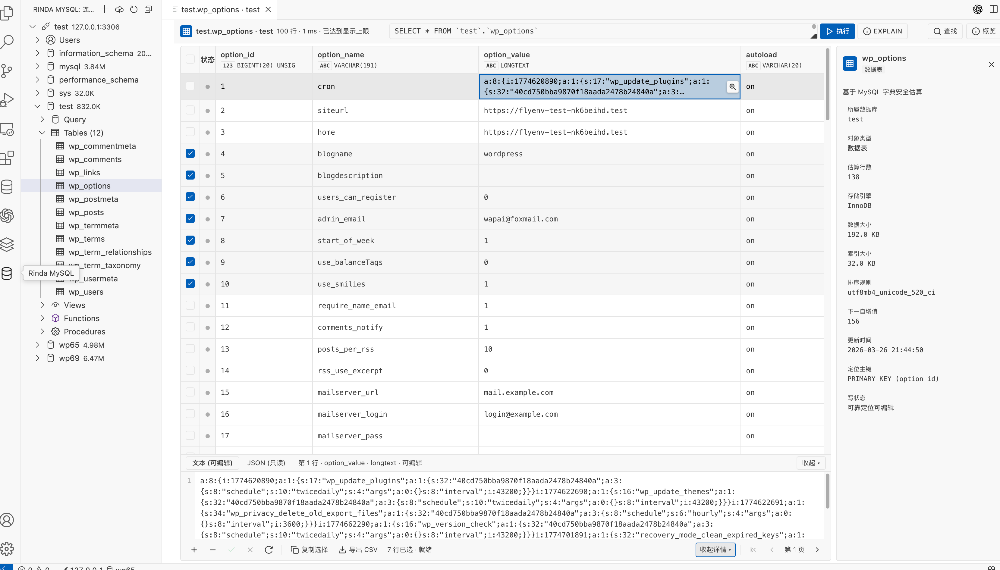
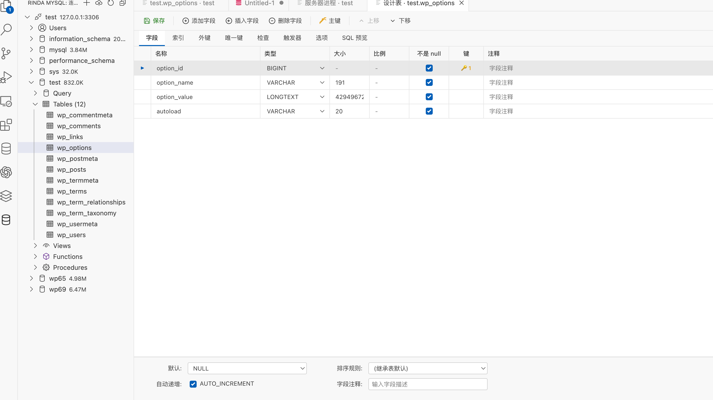
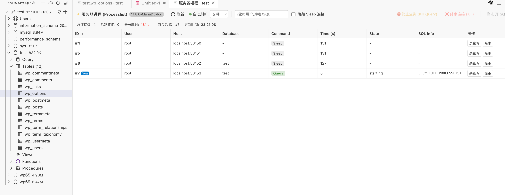
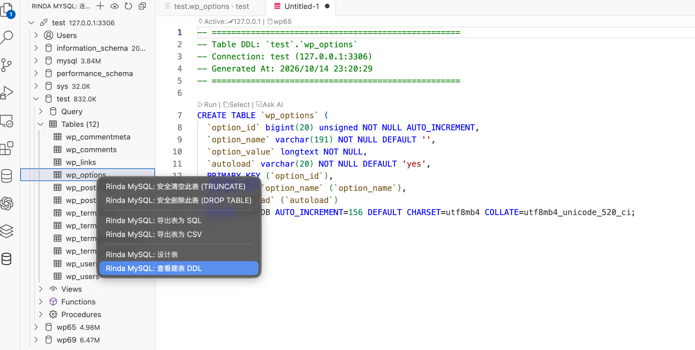

# Rinda MySQL

  <strong>类似 Navicat 优雅体验的 VS Code 全功能 MySQL / MariaDB 客户端管理工具</strong>

  专为开发日常打造：顺滑的高亮与框选交互、可视化表设计器、实时慢查询阻断与执行计划分析。

---

## 界面展示

| 1. 连接管理配置 | 2. 表详情与类似 Navicat 数据网格 |
| :---: | :---: |
|  |  |
| **3. 可视化表设计器 (Table Designer)** | **4. 服务器进程监控与慢查询阻断** |
|  |  |
| **5. 一键查看建表 DDL** | |
|  | |

---

## 核心功能概览

### 1. 类似 Navicat 的数据网格（Result Grid & Details Drawer）
- **顺滑交互**：整行浅色悬浮、深色选中高亮，支持按住鼠标左键连续拖拽框选多行多列区域。
- **就地编辑与丰富右键菜单**：双击单元格直接就地修改；右键支持复制值、复制整行、复制为 `INSERT` 语句、设为 `NULL`、设为空串、批量删除行；工具栏 `+` 按钮一键插入新行草稿。
- **底部详情抽屉**：选中单元格后底部弹出折叠面板，支持大文本多行编辑，JSON 字段只读格式化与高亮查看。
- **表头快速排序与检索**：点击任意列头即时升序/降序排列，支持 `Cmd/Ctrl+F` 快速查找匹配，非单表查询自动开启只读保护。

### 2. 可视化表设计器（Table Designer）
- **直观编辑表结构**：支持新建表与已有表结构修改，可视化定义列名、数据类型、长度/精度、非空、主键、自增、字符集与注释。
- **索引与表选项管理**：支持 `INDEX`、`UNIQUE`、`FULLTEXT`、`SPATIAL` 复合索引与 `BTREE`/`HASH` 算法；自由配置存储引擎（`InnoDB`/`MyISAM`）、字符集与自增初始值。
- **增量 DDL 预览**：智能比对结构差异，实时生成高精度无损的 `ALTER TABLE` 语句。

### 3. SQL 查询、选段执行与 EXPLAIN 分析
- **项目级存储**：查询 `.sql` 文件自动归档在当前项目根目录 `.rinda/queries/` 文件夹下，随项目代码 Git 协同共享。
- **选中即跑**：按 `Cmd+R` / `Ctrl+R` 快捷执行鼠标框选的任意 SQL 片段；自动识别文件头部注释智能切换数据库上下文。
- **一键执行计划**：快捷键 `Cmd+Alt+X` 或点击 `[⚡ EXPLAIN]` 按钮，表格化展示执行计划输出，带 `ALL` 全表扫描红标、`eq_ref` 绿标等彩色指示胶囊。
- **智能元数据补全**：自动提示表名、列名，支持表别名自动推导（如 `FROM users u` 后输入 `u.` 自动识别列名）与函数 Snippets。

### 4. 服务器监控与卡死进程查杀（Processlist）
- **实时进程监控**：查看当前 MySQL 活跃连接与执行中的查询（`SHOW FULL PROCESSLIST`），智能识别自身连接会话（标注 `You` 标签防误杀）。
- **一键阻断卡死**：支持 `KILL QUERY`（阻断慢查询保留连接）与 `KILL`（终止连接会话），提供防误杀确认弹窗。
- **慢查询预警与排查**：超过 30 秒自动标红警示，支持「隐藏 Sleep 连接」、实时模糊搜索与定时自动刷新（2s / 5s / 10s）。

### 5. 数据库管理与导入导出
- **图形化建库与查看 DDL**：引导式配置字符集与排序规则；右键一键查看完整格式化的 `SHOW CREATE TABLE` 页面。
- **安全导入与导出**：支持整库导出 SQL、单表导出 SQL / CSV；严苛的受控维护机制保护生产数据安全。

---

## 常用快捷键

| 功能 | macOS | Windows / Linux |
| :--- | :--- | :--- |
| **执行选中的 SQL (Run Selected SQL)** | `Cmd + R` | `Ctrl + R` |
| **执行全文 / 当前语句** | `Cmd + Enter` | `Ctrl + Enter` |
| **分析执行计划 (Explain SQL)** | `Cmd + Alt + X` | `Ctrl + Alt + X` |
| **表格数据过滤搜索** | `Cmd + F` | `Ctrl + F` |

---

## 扩展配置

在 VS Code 设置中搜索 `rindaMysql` 即可配置：
- `rindaMysql.storageDirectory`: 项目内查询与导出的存储目录（默认 `.rinda`）
- `rindaMysql.queryTimeout`: 查询超时时间（默认 `30000` ms）
- `rindaMysql.maxRows`: 单次最大展示行数（默认 `500`）
- `rindaMysql.mysqldumpPath`: 自定义 `mysqldump` 可执行文件路径
- `rindaMysql.mysqlPath`: 自定义 `mysql` 客户端路径

---

## 版本更新历史 (Changelog)

### v0.3.20
- **GitHub 开源仓库与全网 CDN 镜像对齐**：全面绑定 `orion-ai1/rinda-db-management` 开源仓库，实测大图通过 GitHub Raw CDN 秒级公网直连；
- **界面展示画廊全景修复**：彻底解决 Marketplace 网页端由于仓库未初始化导致的 404 图片失效问题；
- **全新 3D 数据库专属 Logo**：内嵌科技深蓝渐变立体数据库应用图标。

### v0.3.19
- **全新官方专属 Logo**：引入现代化深蓝渐变 3D 数据库立体架构与极速闪电徽章图标；
- **商城规范与分类合规**：规范化扩展分类为官方标准分类，完备优化检索关键词；
- **版本演进历史完整回溯**：在说明文档中补充了自 v0.1.0 至今完整的版本演进记录。

### v0.3.18
- **服务器进程列表（Processlist）**：新增实时连接与慢查询监控面板，带呼吸灯与定时自动刷新（2s / 5s / 10s）；
- **一键 KILL 阻断**：支持 `KILL QUERY` 阻断慢查询（保留连接）与 `KILL` 终止连接，具备当前管理会话识别与防误杀二次确认；
- **排查体验优化**：新增慢查询超过 30s 自动标红预警、一键「隐藏 Sleep 连接」与进程 SQL 一键提取到独立编辑器。

### v0.3.17
- **项目级隐藏文件夹存储**：查询 `.sql` 默认归档于项目根目录 `.rinda/queries/<conn>/<db>/`，随项目代码 Git 协同流动；
- **选中部分 SQL 快捷执行**：支持 `Cmd/Ctrl+R` 直接执行选中的 SQL 片段，支持智能数据库上下文切换；
- **SQL 智能补全升级**：支持表别名自动推导（如 `FROM users u` 后输入 `u.` 补全字段）与反引号解析。

### v0.3.16
- **一键执行计划分析（EXPLAIN）**：支持快捷键 `Cmd/Ctrl+Alt+X` 或结果栏按钮分析 SQL 慢查询瓶颈；
- **性能状态胶囊指示**：直观展示 `ALL` 全表扫描红标、`eq_ref`/`const` 绿标与 `range` 蓝标；
- **结果面板格式统一**：所有 SQL 执行与 EXPLAIN 结果统一复用数据网格，非单表查询自动开启只读保护。

### v0.3.15
- **可视化表设计器（Table Designer）**：支持新建表与已有表结构可视化修改；
- **全要素字段与索引管理**：可视化配置字段名、数据类型、长度/精度、主键、自增、非空与多列复合索引（INDEX/UNIQUE 等）；
- **增量 DDL 预览**：智能比对表结构差异，实时生成高精度的增量 `ALTER TABLE` 语句。

### v0.3.14
- **鼠标拖拽连续框选**：数据网格支持鼠标左键按住拖拽连续框选单元格与整行区域；
- **丰富右键操作菜单**：新增复制值、复制整行、复制为 INSERT 语句、设为 NULL、设为空串、删除选中行；
- **表格新增记录**：工具栏增加 `+` 按钮，支持就地新增行并原子提交草稿。

### v0.3.13
- **仿 Navicat 交互手感升级**：浅色悬浮、深色选中、单元格双击就地编辑；
- **底部详情抽屉（Details Drawer）**：支持大文本多行编辑与 JSON 字段只读高亮/格式化；
- **表头快速排序**：点击任意列头即可快速按该列升序/降序排列。

### v0.3.12
- **图形化新建数据库**：向导式设置库名、字符集（utf8mb4 等）与排序规则；
- **一键查看建表 DDL**：右键任意表快捷查看格式化的完整 `SHOW CREATE TABLE` 页面。

### v0.3.11
- **整库导出 SQL**：通过 `mysqldump` 管道安全导出全库结构与数据，机密凭证不落盘；
- **单表导出 SQL 与流式 CSV**：导出保留高精度数字与日期，内置公式注入防御机制。

### v0.3.10
- **数据库多级对象树**：按数据库展开查询、表、视图、函数、存储过程与用户；
- **凭证安全隔离**：连接密码强制使用 VS Code 系统的 `SecretStorage` 独立加密存储。

### v0.3.4
- **仿 Navicat 表操作界面重构**：升级为高密度数据网格，支持网格就地暂存编辑与多行记录原子事务批量提交；
- **底部详情抽屉**：单元格选中后底部联动展开详情面板，支持大字段文本多行查看与编辑；
- **源表概览侧栏**：右侧实时展示表引擎、行数估算、数据长度与自增步长等核心元数据。

### v0.3.0 ~ v0.3.3
- **高风险受控维护**：支持受控清空表（`TRUNCATE TABLE`）、删除表（`DROP TABLE`）与删除数据库，严格执行两阶段确认防误删；
- **SQL 脚本恢复引擎**：支持大体积 SQL 备份脚本的安全解析与受控恢复，实时反馈执行进度与错误中断；
- **安全导出体系**：支持全库结构与数据导出、单表 SQL 导出与流式防公式注入 CSV 导出。

### v0.2.2
- **单行安全删除**：针对具备可靠主键或唯一键的单表行记录开放安全删除，严格执行整行快照比对；
- **二次防误删确认**：弹出安全确认面板展示库表、定位键与行摘要，需手动输入 `DELETE` 文本方可启用删除。

### v0.2.1
- **单行就地安全编辑**：支持普通数据列直接修改，编辑面板支持 NULL 开关与字段级类型/长度即时校验；
- **并发冲突拦截与短事务**：前端使用一次性行令牌防篡改，后端短事务通过 `SELECT ... FOR UPDATE` 校验整行快照，并发变化自动回滚并提示。

### v0.2.0
- **可靠键定位与只读保护**：优先识别主键与完整唯一键，无可靠键、前缀索引或定位列缺失时整表自动降级为只读保护；
- **安全操作架构**：Webview 与插件核心采用纯结构化意图协议交互，拒绝直接拼接执行未经校验的危险操作语句。

### v0.1.2
- **当前 SQL 可编辑重跑**：结果页顶部展示本次执行的完整 SQL，支持就地修改并一键重新执行（`Cmd/Ctrl+Enter`）；
- **源表安全概览**：免全表扫描读取 `information_schema.tables`，快速呈现估算行数、存储引擎、编码与索引大小。

### v0.1.1
- **单一 Webview 连接表单**：新建与编辑连接由逐项弹窗改为单面板一次性配置，输入体验更加直观流畅；
- **长字段两行省略与详情弹层**：表格长文本超出两行自动显示省略号，点击「查看详情」弹出完整内容弹窗并支持一键复制。

### v0.1.0
- **首个基础版发布**：支持 MySQL 5.7+ / MariaDB 基础连接管理、连接池生命周期维护与测试连接；
- **凭据安全隔离**：连接密码强制写入 VS Code `SecretStorage` 独立加密存储，绝不硬编码或存入明文配置；
- **对象树与 SQL 查询**：侧边栏连接-库-表树状浏览，支持编写 SQL、选区优先执行、默认超时中断与分页结果网格预览。

---

## 开源协议

本项目采用 MIT 授权协议，详见 LICENSE.txt。
